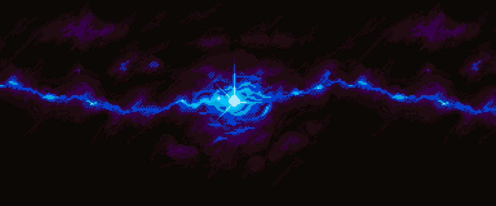

# Space Shooter

A small 2D side-scrolling space shooter written in modern C++17 with
[raylib](https://www.raylib.com/). You fly a ship on the left side of the
screen. Enemy ships keep coming from the right, and they shoot back. Destroy as
many of them as you can without getting hit.



---

## Project description

### Features

- Smooth movement that does not depend on the frame rate (every speed is in pixels per second).
- Up to 4 player lasers on screen at the same time.
- Enemies appear at random heights every 1.5 s, with at most 4 on screen.
- Enemies shoot back: twice a second, a random visible enemy fires a laser.
- Collision detection uses the sprites' bounding rectangles.
- Score, best score for the session, pause, a game-over screen and instant restart.

### Project layout

```
SpaceShooter/
├── Makefile          # the only build system: fetches + builds raylib, builds the game
├── assets/           # textures (copied next to the executable on build)
│   ├── MainBG_zloty.png  background
│   ├── MainBG.png        alternative background (unused)
│   ├── player2.png       player ship
│   ├── enemy.png         enemy ship
│   └── shoot1.png        laser
└── src/
    ├── main.cpp      # entry point: RAII window, asset discovery, error handling
    ├── Config.h      # all tunable constants (screen size, speeds, timings, score)
    ├── Texture.h/.cpp# OwnedTexture (RAII, move-only) and the Assets bundle
    ├── Entities.h/.cpp # Entity base class + Player, Enemy, Laser
    └── Game.h/.cpp   # game state machine, update/draw loop, spawning, collisions
```

### Architecture

| Component      | Responsibility |
|----------------|----------------|
| `Window` (main.cpp) | Opens the raylib window and OpenGL context, and closes them when it goes out of scope. |
| `OwnedTexture` | Owns a single `Texture2D` (RAII). It can be moved but not copied, so each texture is unloaded exactly once. |
| `Assets`       | Loads every texture once and throws a `std::runtime_error` with the path if a file is missing. |
| `Entity`       | Holds the position and a non-owning texture reference. It provides the bounding box, collision, drawing and an off-screen test. |
| `Player` / `Enemy` / `Laser` | Each one overrides `update(dt)` with its own movement logic. |
| `Game`         | Owns all entities in `std::vector`s and runs the Playing / Paused / GameOver state machine. |

Each frame runs in two separate phases:

1. **`update(dt)`** reads input, advances timers, spawns entities, moves everything,
   resolves collisions and removes dead entities (erase–remove idiom).
2. **`draw()`** renders the current state without changing it (it is `const`).

---

## Building

The project uses only a **Makefile**. Visual Studio is not needed. On the
first build the Makefile clones raylib (version 5.5 by default) into
`external/raylib` and compiles it into a static library, `build/raylib/libraylib.a`.

### Requirements

| Platform | Packages |
|----------|----------|
| Debian / Ubuntu | `sudo apt install build-essential git libgl1-mesa-dev libx11-dev libxrandr-dev libxinerama-dev libxcursor-dev libxi-dev` |
| Fedora   | `sudo dnf install gcc-c++ make git mesa-libGL-devel libX11-devel libXrandr-devel libXinerama-devel libXcursor-devel libXi-devel` |
| Arch     | `sudo pacman -S base-devel git mesa libx11 libxrandr libxinerama libxcursor libxi` |
| macOS    | Xcode Command Line Tools (`xcode-select --install`) |
| Windows  | [MSYS2](https://www.msys2.org/) with MinGW-w64: `pacman -S mingw-w64-x86_64-gcc make git`. Build from the MSYS2 MinGW shell. |

### Commands

```bash
make            # release build -> build/release/space_shooter
make run        # build and start the game
make debug      # debug build with AddressSanitizer + UBSan -> build/debug/space_shooter
make clean      # remove game build outputs (keeps the compiled raylib)
make distclean  # remove everything, including the downloaded raylib sources
```

Useful variables:

```bash
make RAYLIB_VERSION=5.0     # use another raylib tag
make CXX=clang++            # use another compiler
make -j8                    # parallel build
```

The build copies the textures into `build/<mode>/assets/`. The game looks for an
`assets/` folder next to the executable first and then in the current working
directory. You can therefore move the `build/release` folder anywhere.

---

## Manual

### Goal

Shoot down enemy ships to earn points. If an enemy ship or an enemy laser
touches your ship, the game ends.

### Controls

| Key | Action |
|-----|--------|
| `W` / `↑` | Move up |
| `S` / `↓` | Move down |
| `A` / `←` | Move left |
| `D` / `→` | Move right |
| `Space`   | Fire a laser (at most 4 of your lasers can be on screen at once) |
| `P`       | Pause / resume |
| `Enter`   | Restart after game over |
| `Esc`     | Quit |

### Rules

- Each destroyed enemy gives **10 points**.
- The current score and the best score of the session are shown in the top-right corner.
- Your ship cannot leave the screen.
- Enemies that fly past the left edge disappear. They do not cost you anything,
  but they do not give points either.

### Tuning

All gameplay constants are in [`src/Config.h`](src/Config.h): window size,
ship, enemy and laser speeds, spawn and shot intervals, the maximum number of
lasers and enemies, and points per kill. Change a value and run `make` again.

---

## Changes compared with the original Visual Studio version

The project was moved off Visual Studio, refactored, and these defects were fixed:

1. **Hard-coded absolute asset paths** (`C:/SpaceShooterProject/...`). The game
   only ran on one machine. Assets are now found relative to the executable.
2. **Non-standard C++.** Declarations such as `void AbstractObject::drawObject();`
   inside derived classes only compiled with MSVC. The code now uses standard
   `override`.
3. **Elements skipped when erasing from a vector inside an index loop.** Lasers
   and enemies could be skipped, and `allShots` could be accessed out of bounds
   through the separate `shootItr` counter. Replaced with the erase–remove idiom,
   and the redundant counters were removed.
4. **Hidden enemies were still collidable.** "Inactive" enemies waited at the
   right screen edge. They could still be hit by lasers and could kill the
   player near the right border. Enemies are now created when they spawn and
   destroyed when they die.
5. **Enemy fire could stop.** The round-robin shooter index only advanced when
   the current enemy was visible, so enemy fire could freeze. A random visible
   enemy now shoots.
6. **Uninitialized `draw` flag** in `EnemyShip` (undefined behaviour).
7. **Wrong hitboxes.** Collisions used ±20 px around the sprite's top-left
   corner. They now use the real sprite rectangles.
8. **Enemy lasers spawned at the wrong height** (they used the player texture's
   height). They now come from the enemy's nose.
9. **Player could fly off the right and bottom edges** (wrong bounds and
   hard-coded `583` / `1400`). The player is now clamped to the window.
10. **Frame-rate-dependent movement.** Speeds were in pixels per frame. They are
    now multiplied by the frame delta time, which is clamped so a stall cannot
    make objects skip through each other.
11. **Game logic inside draw calls.** Movement happened in `drawObject()`, and
    `DrawFPS` was called once per object. Update and draw are now separate.
12. **Abrupt exit on death.** The window used to close immediately. There is now
    a game-over screen with restart.
13. **Raw `new`/`delete`, mutable globals, `static` variables in headers,
    leftover `std::cout` debug output.** All replaced by value members, RAII and
    `constexpr` configuration.
14. **`LaserBullet` used private inheritance by mistake** (`class LaserBullet : AbstractObject`).
